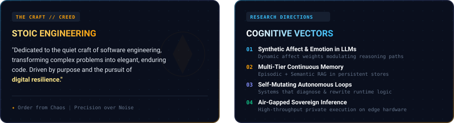
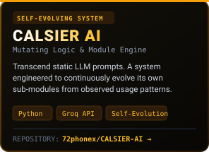

<div align="center">



</div>

<div align="center">



</div>



### `$ ls ~/projects`

<div align="center">

<a href="https://github.com/72phonex/karin-ai"></a>
<a href="https://github.com/72phonex/AI--chatbot"></a>
<a href="https://github.com/72phonex/CALSIER-AI"></a>

</div>


### `$ cat research_focus.txt`

```text
> Memory & continuous learning
> Emotional state in language models
> Autonomous reasoning loops
> Persistent AI architecture
```

### `$ ./roadmap.sh`

<div align="center">



</div>


### `$ cat stack.txt`

<div align="center">


</div>

### `$ git stats --user 72phonex`

<div align="center">


</div>

<div align="center">



*Building toward Jarvis. One commit at a time.*

</div>
