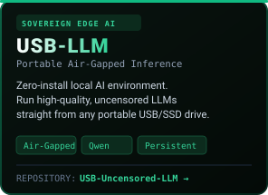
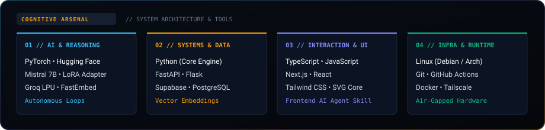

<!-- HERO BANNER -->

  

<!-- STOIC CREED & RESEARCH VECTORS BENTO -->

 

<!-- SECTION DIVIDER -->

### ◈ FEATURED ARCHITECTURES

 

<!-- SECTION DIVIDER -->

### ◈ TRAJECTORY // 2026 ROADMAP

  

<!-- SECTION DIVIDER -->

### ◈ ARSENAL // PRODUCTION & COGNITIVE STACK

  

<!-- FOOTER SEAL -->

 

<!-- TRANSMISSION / CONNECT -->

  
  
  

